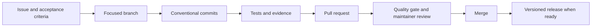

<div align="center">


# Contributing to Abstract

From a reproducible issue to a verified change.
</div>

## Contents

- [Workflow](#workflow)
- [Before starting](#before-starting)
- [Branches and commits](#branches-and-commits)
- [Verification](#verification)
- [Evidence](#evidence)
- [Pull requests](#pull-requests)
- [Issues](#issues)
- [Component boundaries](#component-boundaries)

## Workflow



Pull requests target `main`. Describe the actual work and checks; importing
existing work is a source import, not a claim that it was first authored now.
Use real commit timestamps and report only tests that ran.

## Before starting

Read the [documentation index](docs/README.md), the [language specification](docs/reference/specification.md),
and the [compatibility contract](docs/compatibility.md). Search existing issues.
For a syntax, diagnostic, output, or protocol change, discuss the contract and
migration in an issue before implementing it. Small fixes can go straight to a
PR with a reproducer and clear scope.

Never include credentials, customer data, private machine paths, local assistant
instructions, or generated packages. Keep assistant rules and skills in a local
configuration outside tracked source. Review `git status --short` and
`git diff --cached` before committing. Use GitHub's noreply address if you do not
want a personal address in public commit metadata; changing files later does
not remove addresses from earlier commits.

## Branches and commits

Choose a short branch name such as `wip/42-diagnostic-range` or `wip/compiler-tests`.
Keep unrelated work in separate PRs. Commit messages use English Conventional Commits:

```text
fix(parser): reject an incomplete range

Explain the trigger, resulting behavior, and relevant verification.
Refs #42.
```

Use `feat`, `fix`, `docs`, `test`, `refactor`, `build`, `ci`, or `chore`. Scope
names should identify the component: `compiler`, `parser`, `vscode`, `java`, or
`release`. Breaking changes need `!` and a `BREAKING CHANGE:` footer describing
the consumer migration. Preserve a useful sequence of implementation, regression
coverage, and documentation; do not pad the history with empty changes.

## Verification

Run the checks relevant to the component, then review the complete CI result:

```sh
python scripts/check-repository-hygiene.py --self-test
python scripts/check-repository-hygiene.py
python scripts/check-release-manifest.py
cargo fmt --all -- --check
cargo clippy --locked --all-targets -- -D warnings
cargo test --locked
cargo build --locked --bin abstract
```

For the editor, run `npm ci`, `npm test`, and `npm run package` in `vscode/`.
Point `ABSTRACT_COMPILER_PATH` to the built executable. Host tests run with
`npm run test:integration` and `npm run test:integration:public`; Linux requires
`xvfb-run --auto-servernum`. Public inventory tests also require a real prior
compiler, supplied by CI from the `compat-compiler-1.1.0` snapshot. See the
[editor guide](vscode/docs/authoring.md) for environment variables and Restricted Mode.

For Java, set `ABSTRACT_COMPILER_PATH` and run
`mvn --batch-mode --file java/pom.xml verify`. CI uses Java 8 and 21; without
the compiler path the optional local bridge test may skip, so explicitly report
that limitation rather than calling it full compatibility coverage.

The `Quality gate` requires every component job to succeed. The 21 historical
Rust cases marked ignored assert superseded language rules; their reasons cite
the current specification, and active conformance cases cover the replacement
rules. New behavior belongs in active tests.

## Evidence

Use small synthetic inputs and show their expected output or diagnostic. For
editor UI changes, add before/after screenshots or a short recording from a
real extension host. A diagram explains a design; it does not replace an
execution result. State which platform and host version ran.

Keep original private logs outside Git. Remove usernames, private paths,
credentials, customer data, and unrelated windows before publishing evidence.
Generated illustrations should be identified as illustrations, not product
screenshots. Keep public evidence small and place reusable README media under
`docs/readme/`.

## Pull requests

Use the repository template. Lead with the user-visible problem and result,
then explain technical decisions and compatibility. Link the issue with
`Closes #42` only when its acceptance criteria are met. Remove sections that do
not apply; do not leave placeholder diagrams or invented results.

Include a diagram when a change crosses components. Verification lists exact
commands, results, and material omissions. Describe version changes, data or
configuration changes, artifact effects, and rollback where relevant. The
maintainer merges through GitHub after the checks pass; no independent reviewer
approval is claimed when the maintainer is the only reviewer.

## Issues

- **Bug report:** minimal input, reproduction, expected/actual result, version,
  platform, and diagnostic.
- **Improvement:** the user's problem, proposed result, acceptance criteria,
  compatibility, and explicit exclusions.
- **Language change:** exact syntax or protocol proposal, affected specification
  section, positive/negative examples, and migration.
- **Documentation:** the page or example that is unclear and the reader's goal.

Report vulnerabilities privately using [SECURITY.md](SECURITY.md), not a public
issue. Participation follows the [Code of Conduct](CODE_OF_CONDUCT.md).

## Component boundaries

| Component | Owns | Verification |
| --- | --- | --- |
| `src/`, `tests/` | Compiler semantics, diagnostics, output, resource rules | Rust and conformance suites |
| `vscode/` | Editing, navigation, compiler process integration, trust behavior | Unit tests and real extension hosts |
| `java/` | Reading compiled documents and authenticated bundles | Java 8/21 and compiler bridge |
| `examples/`, `docs/` | Executable teaching projects and public contracts | Example-output tests and reference review |
| `.github/`, `scripts/` | CI gates, artifact verification, release packaging | Workflow lint, quality gate, shipped-binary checks |

Code contributions use the existing [MIT license](LICENSE). Maintainer roles
and decision-making are described in [GOVERNANCE.md](GOVERNANCE.md).
