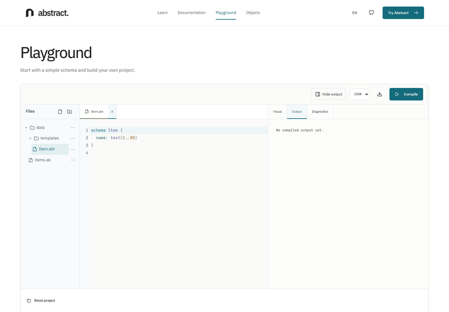
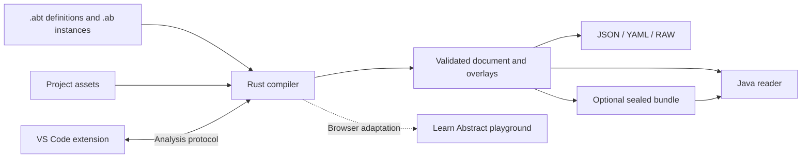

<div align="center">


# Abstract

A declarative data language for real-world objects and their variations.<br>
Define typed schemas and rules, then compile validated JSON, YAML, or RAW.

[](https://github.com/adrienverhaert/abstract/actions/workflows/ci.yml)
[](Cargo.toml)
[](vscode/README.md)
[](LICENSE)

**[Try it in your browser](https://learn-abstract.vercel.app/en/playground/) · [Learn](docs/learn/README.md) · [Reference](docs/README.md) · [Downloads](https://github.com/adrienverhaert/abstract/releases)**


</div>

## Overview

Abstract keeps the structure of a family of objects alongside the rules its
instances must satisfy. A schema declares the properties; instances provide
values and can reuse other instances while writing only their differences.
The compiler checks the source and emits data for the application that consumes it.

Use it for related configurations, catalogues, resource-backed models, or
versioned datasets. The compiler is a developer tool; it is not a hosted service
or a general-purpose application runtime.

## Contents

- [Tour](#tour)
- [Architecture](#architecture)
- [Repository layout](#repository-layout)
- [Stack and contracts](#stack-and-contracts)
- [Quick start](#quick-start)
- [Verification and releases](#verification-and-releases)
- [Documentation](#documentation)
- [Contributing](#contributing)

## Tour

A definition and an instance are separate source files. This is the runnable
[`hello` example](examples/features/hello/):

<table>
<tr><th>Definition · <code>Label.abt</code></th><th>Instance · <code>hello.ab</code></th></tr>
<tr><td>

```abstract
schema Label {
    caption: text(1..40)
}
```

</td><td>

```abstract
Label :: @id.hello
    caption: "Hello, world"
```

</td></tr>
</table>

Run `abstract compile examples/features/hello JSON`. The compiled document
contains the validated instance, compiler/document versions, and model overlays.
A bad value produces a source diagnostic instead of silently entering the output.

The same compiler is used by the separate browser integration. The recording
below shows a real starter compilation and its visual result:

[](https://learn-abstract.vercel.app/en/playground/)

| Capability | What it provides | Start here |
| --- | --- | --- |
| Schemas and validation | Types, constraints, defaults, references, and logic | [Language guide](docs/language.md) |
| Variations and versions | Reuse shared values, then express differences and model changes | [Tutorials](examples/README.md) |
| Resources | Validate declared file/image constraints against project assets | [Feature projects](examples/features/README.md) |
| Editor integration | Schema-aware completion, diagnostics, navigation, and checked refactoring | [VS Code extension](vscode/README.md) |
| Compiled-data readers | Document envelopes, overlays, and authenticated bundles | [Java runtime](java/README.md) |

## Architecture



| Boundary | Responsibility |
| --- | --- |
| Compiler | Parse, validate, resolve values and versions, and render checked output. |
| VS Code extension | Capture editor state and present compiler-backed results; executing a configured compiler requires Workspace Trust. |
| Java reader | Consume the compiled contract without reproducing language compilation. |
| Browser integration | Run the compiler in a Web Worker through WebAssembly; maintained in [Learn Abstract](https://github.com/adrienverhaert/learn-abstract). |

## Repository layout

```text
abstract/
├── src/                    Rust compiler and command-line entry point
├── tests/                  Unit, integration, conformance, and fixture checks
├── examples/               Tutorials, feature projects, and guided exercises
├── vscode/                 Extension, grammars, host tests, and packaging
├── java/                   Optional Java compiled-data reader
├── docs/                   Learning path, specification, protocols, and releases
├── scripts/                Version checks, artifact verification, and installers
├── .github/                CI/CD, ownership, dependency updates, and templates
├── Cargo.toml              Crate identity and minimum Rust version
└── release-manifest.json   Component and wire-format compatibility values
```

## Stack and contracts

The compiler is a Rust crate and CLI. The extension uses JavaScript and the
VS Code API; its test tooling uses Node.js 22. The optional Maven library runs
on Java 8 and newer. CI checks the compiler with stable Rust and Rust 1.85, the
Java reader on 8/21, and actual VS Code 1.92/stable hosts.

The compiler, language, document format, analysis protocol, extension, and Java
runtime are versioned separately. Their current values live in the
[release manifest](release-manifest.json); the [compatibility guide](docs/compatibility.md)
explains what consumers may rely on.

## Quick start

Build from a checkout with Rust 1.85 or newer:

```sh
git clone https://github.com/adrienverhaert/abstract.git
cd abstract
cargo build --release --locked
cargo run -- init my-project
cargo run -- compile my-project JSON --out my-project.json
```

Or install the CLI from your checkout:

```sh
cargo install --path . --locked
abstract lint examples/features/hello
abstract compile examples/features/hello JSON
```

For prebuilt tools, use the [release downloads](https://github.com/adrienverhaert/abstract/releases)
and follow the [artifact verification guide](docs/releasing.md). The VSIX can be
installed from a local file in VS Code. Java consumers should follow the
[runtime setup](java/README.md); the JAR requires its declared Maven dependencies.

## Verification and releases

Pull requests run repository privacy checks, Rust formatting and Clippy,
compiler tests across Linux/Windows/macOS, minimum-toolchain checks, Java
compatibility, extension unit tests, and real extension-host integration.
Runnable examples are compared with their recorded output. Historical tests
that assert superseded rules remain explicitly marked; current conformance
cases cover the replacement contracts.

The **Quality gate** requires every component check to succeed. Version tags
reuse that gate before producing five native compiler targets, the VSIX, and
the Java library. Each native executable must pass shipped-binary checks,
including sealed-bundle tamper rejection. The final job assembles a draft
release with its compatibility manifest and SHA-256 checksums.

See [CI runs](https://github.com/adrienverhaert/abstract/actions/workflows/ci.yml),
[release runs](https://github.com/adrienverhaert/abstract/actions/workflows/release.yml),
and the [release procedure](docs/releasing.md).

## Documentation

| Goal | Guide |
| --- | --- |
| Learn by building | [Learning path](docs/learn/README.md) and [exercises](examples/exercises/) |
| Understand the language | [Language guide](docs/language.md) and [specification](docs/reference/specification.md) |
| Look up a contract | [Reference index](docs/README.md) |
| Write or review source | [Authoring checklist](docs/authoring/README.md) |
| Integrate the editor or Java reader | [Editor protocol](docs/reference/editor-protocol.md) and [Java guide](java/README.md) |
| Try without installing | [Browser playground](https://learn-abstract.vercel.app/en/playground/) |

## Contributing

Start with the [contribution workflow](CONTRIBUTING.md), then open a reproducible
[issue](https://github.com/adrienverhaert/abstract/issues/new/choose) or a focused
pull request. Language changes should identify the affected contract, examples,
and migration. Verification and evidence belong in the PR, with only actual
results marked as passed.

[Governance](GOVERNANCE.md) · [Code of Conduct](CODE_OF_CONDUCT.md) · [Security](SECURITY.md)

## License

Source code is available under [MIT](LICENSE). The Abstract name and logo are
maintained by Adrien Verhaert. Editorial illustrations and real recording
provenance are described in [README media](docs/readme/MEDIA.md).
